# Changelog

Every release is on the [releases page](https://github.com/XDinka/cult_of_the_lamb_co-op_anything/releases)
with its installer. Both players need the same version.

## 0.9.3 (2026-10-29)

Both players need this version. An urgent fix.

**The friend's enemies keep following the host.** In a shared room the enemies of whoever came in
second (usually the friend) follow those of whoever came in first (usually the host). When the mod
took away the friend's copy of an enemy the host's game no longer had, and that death brought the
next enemy in (a boss's next stage, a brood), the part of the mod that moves the enemies broke and
stayed broken: for the rest of the game the friend's enemies no longer followed the host's, until
the game was restarted. This could be one of the causes of "the final boss breaks": in our test of
the final fight on 0.9.2 it happened on the friend's side when the first guardian died. Now such a
death no longer breaks it.

**And if it ever breaks again, it goes on.** A fault there is written to the log with where it
happened and the enemies keep following from the next frame, instead of stopping for the whole game.

**Tested** on this release's build (two copies of the game on one PC, a loopback stand-in for Steam,
the host on a copy of a real save): a dungeon with the host killing and the friend following, with
enemies taken away on the friend's side by the part that moves them and no unhandled errors in the
mod; a fault made on purpose was logged once and the enemies went on following.

**Not tested:** a death that brings the next enemy in (a boss's stage, a brood) on this build; the
host as the one following (in a room the friend entered first); real two-account Steam play.

**Known issues:**
- In the cult the friend sometimes has only the hearts, without the faith circle and the hunger bar;
  going out of the cult and back in helps. The cause isn't found yet.
- The game's ways back from death: coming back from the corrupted monolith (after the final boss)
  was checked on a 0.9.2 build by the logs on both sides; the partner's figure and the run's clock
  after it aren't checked. The crown's pyre and the Deal aren't tested in online co-op.
- In the final fight the great form's eyes don't die on the friend's side; the fight still plays
  through to the end for both.
- In a dungeon leader's room the room can open and its chest appear while the leader is still
  talking.
- The friend can still get stuck after a scene (black bars, no HUD). Then press the log button in
  the pause menu and send us the log.
- Reported, not yet checked or fixed: shared progress can break; if the host leaves the lobby, the
  friend's menu can hang; a talk with a follower breaks if both players are in it.

<!-- discord-ru
**Срочное обновление: враги у друга снова следуют за хостом.** Если мод убирал у друга врага, которого у хоста уже не было, и после него появлялся следующий (стадия босса, выводок), враги у друга переставали двигаться за хостом до перезапуска игры. Возможно, это одна из причин «ломается финальный босс». Исправлено и проверено в подземелье; стадия босса на этой сборке ещё не проверена. Если такое случится снова, синхронизация не остановится, а продолжит со следующего кадра.
Обоим игрокам нужна эта версия.
Известное: в культе у друга бывают только сердца, без круга веры и шкалы голода (помогает перезайти в культ); возврат через монолит после финала проверен только по логам на 0.9.2 (кукла напарника и часы забега после него не проверены), костёр и «Сделка» в онлайн-коопе не проверены; у друга в финале не умирают глаза босса, бой при этом доходит до конца; в комнате лидера подземелья комната может открыться и сундук появиться, пока лидер ещё говорит; если друг застрял после сцены — кнопка лога в паузе, пришлите лог. Сообщали, ещё не проверено и не исправлено: может ломаться общая прогрессия; если хост выходит из лобби, у друга может зависнуть меню; разговор с последователем ломается, если в нём оба.
Если Windows (Smart App Control) не даёт запустить установщик — используйте install.cmd из архива cotl-coop-anything-0.9.3.zip (см. страницу вики «Это безопасно»).
-->
<!-- discord-en
**Urgent fix: the friend's enemies follow the host again.** When the mod took away the friend's copy of an enemy the host no longer had and that brought the next one in (a boss's stage, a brood), the friend's enemies stopped following the host until the game was restarted. This could be one of the causes of "the final boss breaks". Fixed and checked in a dungeon; a boss's stage on this build isn't tested yet. Should it happen again, the syncing goes on from the next frame instead of stopping.
Both players need this version.
Known: in the cult the friend sometimes has only the hearts, without the faith circle and the hunger bar (going back into the cult helps); coming back from the monolith after the final boss is checked only by the logs on 0.9.2 (not the partner's figure or the run's clock after it), the pyre and the Deal aren't tested online; in the final fight the friend's copy of the boss's eyes doesn't die, the fight still ends; in a dungeon leader's room the room can open and its chest appear while the leader is still talking; if the friend gets stuck after a scene, use the log button in the pause menu and send us the log. Reported, not yet checked or fixed: shared progress can break; if the host leaves the lobby, the friend's menu can hang; a talk with a follower breaks if both players are in it.
If Windows (Smart App Control) won't let the installer start, use install.cmd from the cotl-coop-anything-0.9.3.zip archive (see the Unsigned installer wiki page).
-->

## 0.9.2 (2026-10-29)

Both players need this version.

**Your hearts stay on screen when you're alone in a room** (the likely cause of "the friend's
interface is gone"). When the partner went on ahead, or you came into a room on your own, the game
rebuilt the hearts panel out of sight and the HUD stood without hearts until the partner came back.
The panel now comes back in as the game's own does.

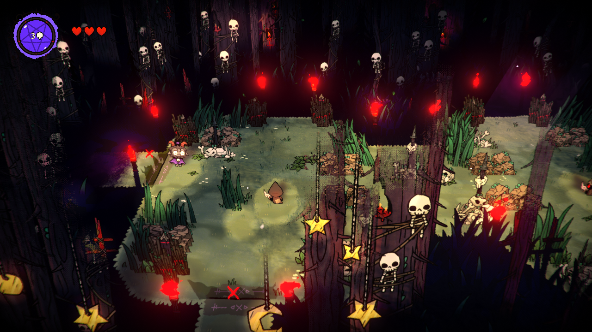

**Conversations hold together.** A conversation that waited for the partner now starts with its
letterbox and the lamb held still; a copy started as a room comes in waits for the host's; a host
whose game lags is waited for, with a line saying so, instead of the friend's copy being cut off
(after a lag the room, the fight or the next talk that hang on it now come on both sides). A
conversation the host leads always ends for the friend too.

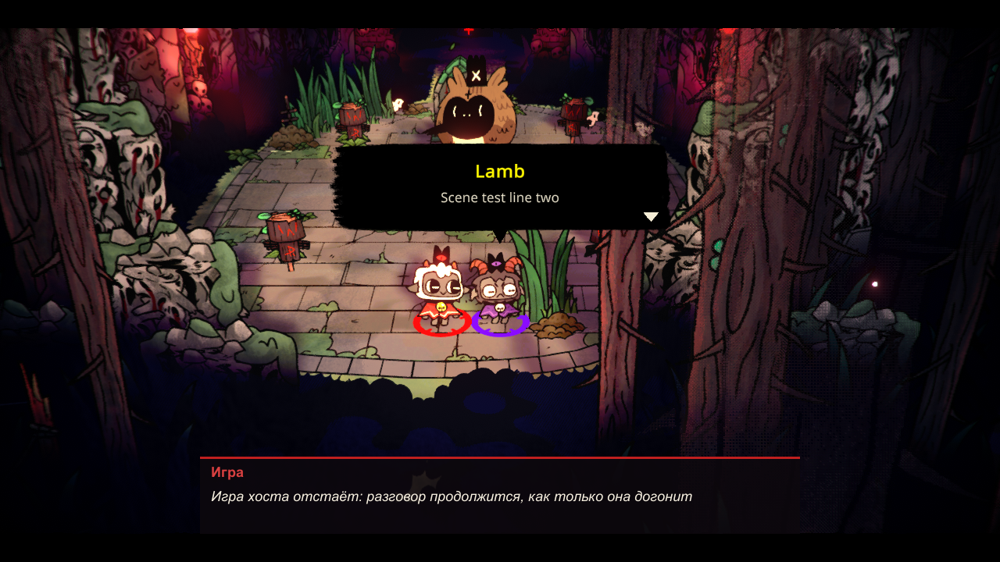

**One death screen for the pair.** Both see the same rooms and the same run time, a lamb no longer
gets up behind its death screen, going home ends the run for both, and nobody lies down for good.
Getting a fallen partner up is the game's own deal: you give them one heart at their side.

**The One Who Waits' fate is asked of both.** At the very end the host's answer decides for the
pair, the friend's pick shows as a vote, and the follower is spared or killed once.

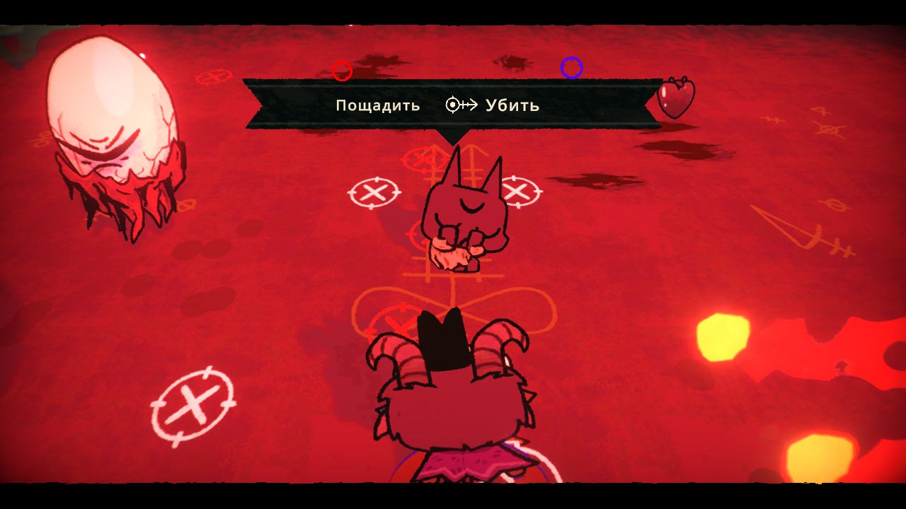

**The partner's puppet keeps out of your way.** The game's own conversations and menus no longer
hand their input to the puppet, so they read on; fleece 4 and 6 deal the tarot only to you, not a
second time to the puppet; and knucklebones at Ratau's or another player's table no longer offers
the match for two with the puppet in the second seat.

**Smaller mendings.** The HUD watchdog leaves the game's own scenes and menus alone (it brought the
HUD up over a chest's new item card); found in a test run and fixed by the code, not tested since:
it also leaves alone the game's room of coming back to life, which hides the HUD on purpose; the
game's walks are never cut short, so a room comes alive
behind its door; the HUD comes in and out in step when the panels are rebuilt.

**Tested** (two copies of the game on one PC, a loopback stand-in for Steam, the host on a copy of a
real save, on this release's build): getting a fallen partner up both ways, by the logs (one heart
given, the partner up with one heart, their figure standing again); the HUD after scenes and alone in
a room, with both sides' frames. On earlier builds of 0.9.2: a conversation that waits and a lagging
host, fleece 4, with both sides' frames; knucklebones, the lobby with a join from the friend's menu
and a called-off reconnect, by the logs. On the stand without a save: the fate and the death screen.

**Not tested:** real two-account Steam play; the game's real conversations (Ratau's, a mini-boss's
intro) and the menus' watchdog with anything but a test conversation; coming into a room alone; the
host left alone; knucklebones at a real table (only test tables); fishing; the host coming into the
first room second.

**Known issues:**
- In the cult the friend sometimes has only the hearts, without the faith circle and the hunger bar;
  going out of the cult and back in helps. The cause isn't found yet.
- The game's ways back from death (the corrupted monolith after the final boss, the crown's pyre,
  the Deal) aren't tested in online co-op; in our runs both players stayed in the monolith's room.
  Deaths on the same save went the same way on an early build of 0.9.2; not compared with 0.9.1.
- In the final fight the great form's eyes don't die on the friend's side; the fight still plays
  through to the end for both.
- The friend can still get stuck after a scene (black bars, no HUD). Then press the log button in
  the pause menu and send us the log.

<!-- discord-ru
**Сердца не пропадают, когда вы одни в комнате** (вероятная причина «у друга пропал интерфейс»).
**Разговоры держатся вместе.** Разговор, ждавший напарника, начинается как положено; при лаге хоста друг ждёт со строкой «Игра хоста отстаёт», и продолжение не теряется.
**Один экран смерти на двоих.** Павшего поднимают, отдав ему одно сердце рядом с ним; уход домой любого заканчивает забег обоим.
**Судьбу Того-кто-ждёт решают за обоих.**
**Кукла напарника не мешает:** разговоры игры, руно с таро и кости у Ратау больше не цепляют её.
Известное: в культе у друга бывают только сердца, без круга веры и шкалы голода (помогает перезайти в культ); воскрешения игры (монолит после финала, костёр, «Сделка») в онлайн-коопе не проверены; у друга в финале не умирают глаза босса, бой при этом доходит до конца; если друг застрял после сцены — кнопка лога в паузе, пришлите лог.
-->
<!-- discord-en
**Your hearts stay when you're alone in a room** (the likely cause of "the friend's interface is gone"): whoever is left behind keeps the HUD.
**Conversations hold together.** A talk that waited for the partner starts properly; with a lagging host the friend waits with a line saying so, and nothing after it is lost.
**One death screen for the pair.** A fallen partner is got up by giving them one heart at their side; either player going home ends the run for both.
**The One Who Waits' fate is decided for both.**
**The partner's puppet keeps out of the way:** the game's talks, the fleece's tarot and Ratau's knucklebones leave it be.
Known: in the cult the friend sometimes has only the hearts, without the faith circle and the hunger bar (going back into the cult helps); the game's ways back from death (the monolith after the final boss, the pyre, the Deal) aren't tested online; the friend's copy of the boss's eyes doesn't die, the fight still ends; if the friend gets stuck after a scene, use the log button in the pause menu and send us the log.
-->

## 0.9.1 (2026-10-28)

**A quest either player finishes counts for the pair.** The partner's quest lists are run through the
game's own completion check as they come in, and the quest tracker is built anew from the lists —
both ways, whoever did the deed.

**The menu knows your friend.** The host names its lobby in the Steam presence too, and the menu
reads it when the friend's game info carries no lobby, so the friend's row shows reliably; a join
that leads nowhere lets the menu go after 20 s with a word. The lobby stays joinable through the
whole game: a running game can be joined, and rejoined, from the menu. The multiplayer tab also
looks at the releases as it opens and offers a newer mod.

**Reconnecting can be called off.** The waiting screen has a real cancel button (Esc works too),
and leaving it says "Connecting again was called off" instead of pretending it failed.

**Smaller mendings.** The host closing the lobby sends the friend straight back to the online menu;
the opening is each player's own again (a knockout there left the player lying unkillable in their
prologue — the game's death stands); and the HUD heals itself: hearts gone mid-run come back, and a
whole HUD left hidden by a scene (only the hearts standing in the base after the ending) shows again.

**Tested:** the quest check and the HUD watch rode the stand pair's dungeon run; the lobby close,
the menu join and the called-off reconnect each played out on the stand.

## 0.9.0 (2026-10-28), beta

**The end of the game is played together.** The last place of the game works as every leader's room
does: the first one in waits by the door, a scene starting for one pulls the other in, and the fight's
keepers, the shadow and the great form stand, fall and carry the story on for both players — each body
a player fells counts for the pair, and the staging (the broken chains, the darkened arena, the one
who remains) follows on both screens. The ending and what it leaves behind land in the host's save.
See `Game/FinalBoss.cs`.

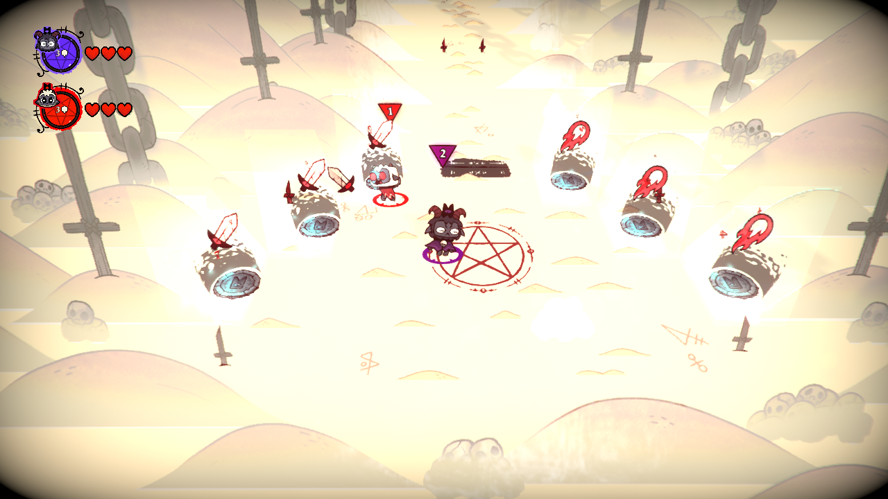
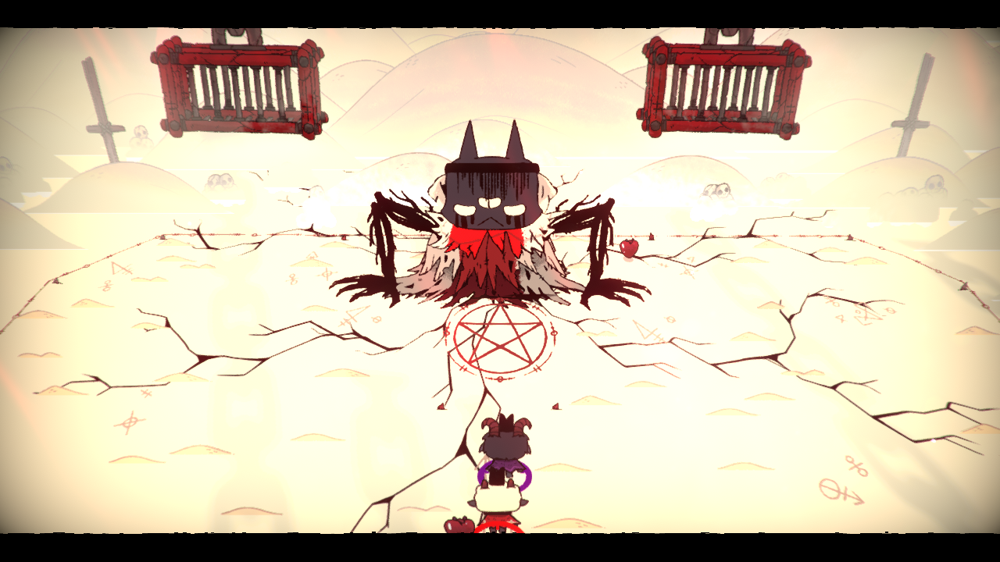

**The crown's question is asked of both.** The choice at the end comes up on both screens with the
players' icons over the answers, as conversations already did: each player sees what the other points
at, the friend's pick is a vote, and the host's hand decides for the pair. Nothing starts until that
answer is given.

**Two players, and the partner's puppet knows its place.** The lobby and the session are for two now.
The partner's stand-in never springs a scene's walked-over triggers, never becomes the game's main
player (that one took the camera, the controls and every icon with it on the friend's side), and the
screen-edge markers, the heads by the hearts and the damage flash all follow who a player looks like,
not the game's lamb-first seating.

**The save is kept safe.** Before the friend's first join of a session the host's save is copied
aside (`saves/cotlmp-backup`), so an early beta can't cost anyone their cult.

**A log button for bug reports.** The pause menu's online page has a button that gathers the game's
log and opens the Discord, so a stumble in the beta is a minute's work to report.

**Smaller mendings.** A session leaves nothing behind for the next one (room ownership, held scenes,
hearts panels, puppets); a knocked-out player can't stay down forever; a frozen leader dies properly
on the partner's side and its heart is taken once for both.

**Tested:** the full final fight on the test stand pair (entrance, podiums, the question, three
stages, the ending) and the leaders of all four lands at all four layers, 16 pairs in one pass.

## 0.3.7 (2026-10-27)

**Arabic reads right in the mod's own boxes.** The partner's lines at the bottom of the screen and the
chat are drawn by the mod (IMGUI), which lays every row out left to right with unjoined letters. The
game joins and turns its Arabic only for its own boxes, and only when it is in Arabic. Now the mod takes
the text as written, breaks it into rows by words first, and only then joins and turns each row with the
game's own shaping (RTLTMPro): a long Arabic line reads its rows top to bottom and stands at the right,
and an Arabic word inside a Latin line is joined and turned where it stands. This works whatever language
the game is in (an Arabic-speaking friend writes to a player whose game is in English). See `Ui/Bidi.cs`.
The partner's fox line in Arabic shows now too: the turned term wasn't found before.

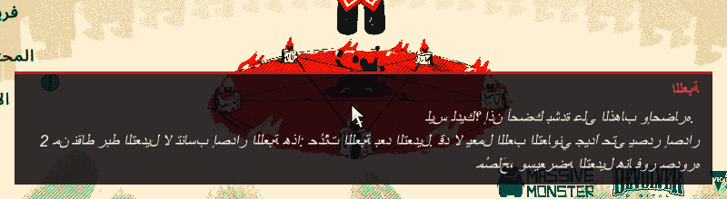
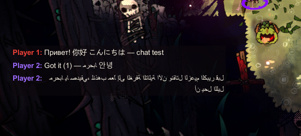

**Bigger heads on the minimap.** Each player's head is as high as the room now (it was about half), so
the Lamb and the Goat side by side read at a glance.

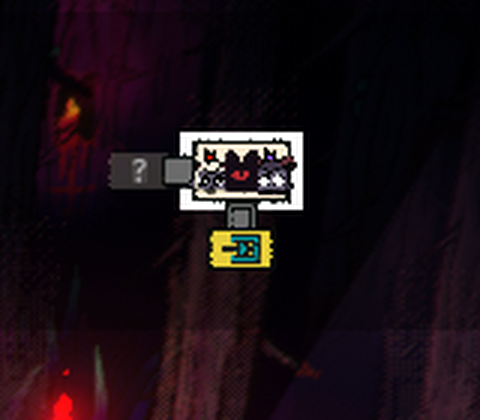

**Tested:** the partner's line box in all 15 languages (Arabic over four rows), the chat both ways in a
run with a mixed and a long Arabic line, the minimap heads in a run.

## 0.3.6 (2026-10-27)

**Coming from 0.3.5: run the installer once more.** From this version the mod is loaded by a small
loader (`COTLMP.Loader.dll`), so later versions can go in without leaving the game. 0.3.5 has no
loader: its update offer restarts the game through the installer this one time.

**A lost connection is taken up again.** When nothing comes from the host for 30 s (not a goodbye:
the host's game or Steam went quiet), the friend doesn't drop to the main menu any more. The game
stops behind the black loading screen with "Connecting 1/3" next to the crown and joins the host
again by itself: the host's save comes anew and the friend is taken back to the host's room with the
hearts and gear they had. Three tries; after the third the friend goes to the main menu with "Lost the
connection to your friend: couldn't connect again in 3 tries". See `Network/Reconnect.cs`.

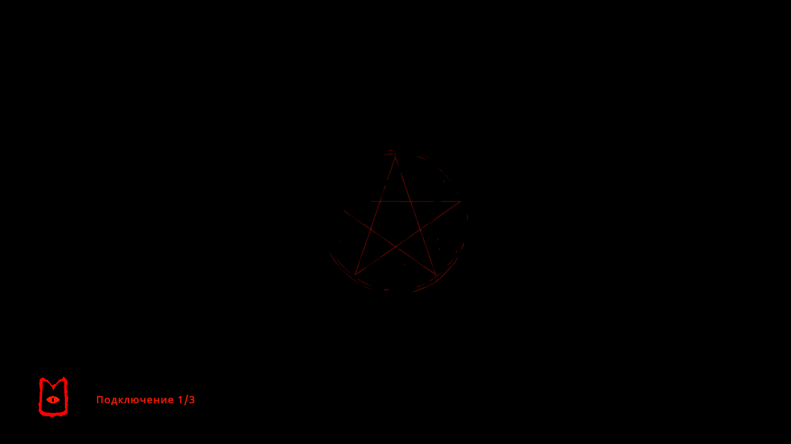
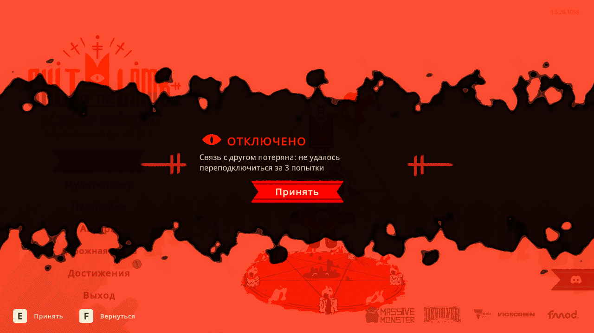

```
friend: [QA] Cutting the link for 45 s (a lost connection)
        Recieve error type TimeoutException message Timed out
        Lost the connection to host 1, connecting again
        Connecting to host 1 again, try 1 of 3
        Try 1 of 3 to connect again didn't get through
        Connecting to host 1 again, try 2 of 3
        Connected to the host again on try 2
        Back with the host: in their room after 0 floors
host:   Friend 2 is back: taking them to Dungeon1#1.1.0@0,2, with what they had 68 s ago
```

**Text chat.** In a session **T** opens a line at the bottom left, **Enter** sends it, **Esc** closes it.
While it is open the game hears nothing of the keyboard or the pad, and gets back exactly the controls
it had on. The last six lines stand at the bottom left with the sender's Steam name (the Lamb's in
red, the Goat's in purple) and fade after 10 s; with the line open the whole history shows. Chinese,
Japanese and Korean show and can be typed (IME). A line that is mostly Arabic is shaped like the
game's own; an Arabic word among Latin ones shows left to right. COTLMP's old chat box (Y) sent
nothing and left the controls off until Esc: it is gone. See `Ui/TextChat.cs`.

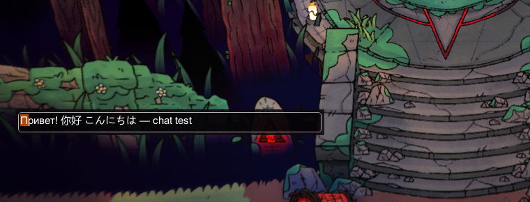
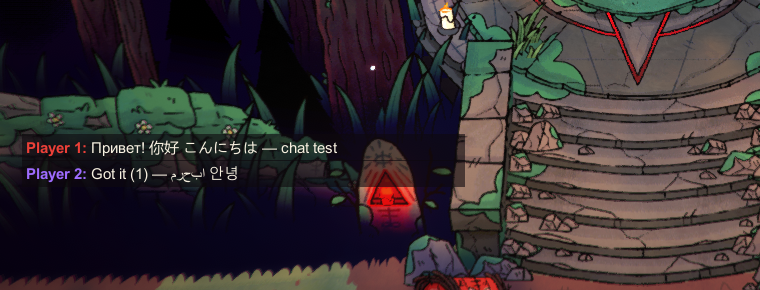

**A game update that breaks part of the mod no longer breaks all of it.** The mod's patches go in
one class at a time when the game starts (as before, no longer to start). One that no longer fits
the game's code is left out and logged with why, and the rest work; before, the first such patch
stopped the whole mod. The main menu tells the player once: with an **update** button when a newer
mod is out, or that a fix is coming and will be offered right there. Entering a session, each side
tells the other: both get a note if either game left patches out. See `Debug/PatchCheck.cs`.

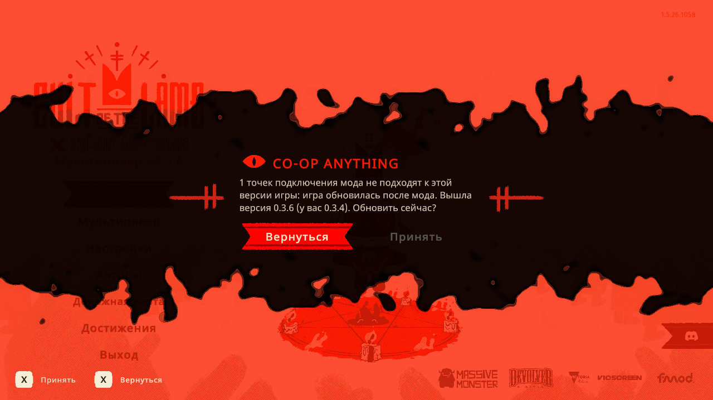
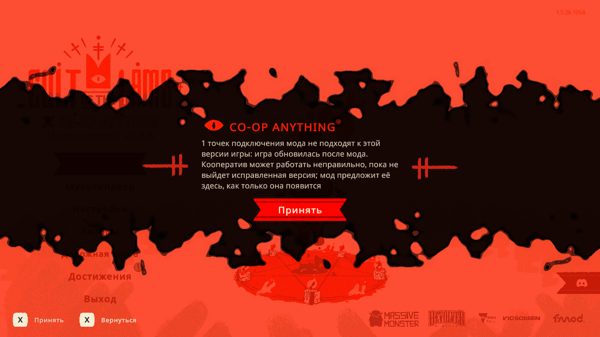

**The mod updates without leaving the game.** A newer release is downloaded and checked (SHA-256)
in the main menu, the old mod lets go of everything it put into the game (patches, events, Steam
callbacks, settings, objects) and the new one starts in its place. An update that doesn't start puts
the old mod back ("The new mod didn't start, back on 0.3.4", tested with a cut archive). Only a version
that needs a new BepInEx or COTL API restarts the game for the installer. During a game, a downloaded
update asks: **Restart the lobby** (the host saves, the lobby opens again on that save and the friend
rejoins), **Restart the game**, or **Later**.

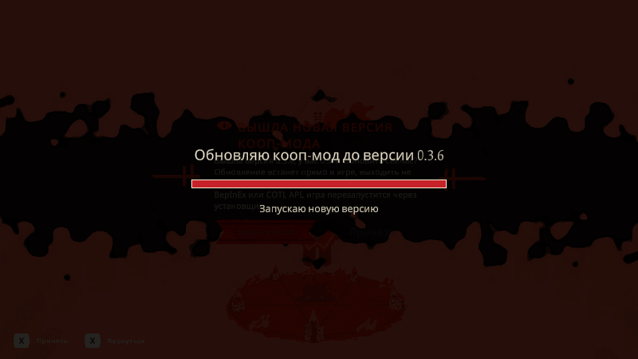

**A friend who comes back gets their things back.** The host keeps how each friend stands in a run
(hearts of every kind, weapon, curse, relic, tarot cards, where they stood) by Steam account, however
they went: left, lost the connection or crashed. A friend who joins during the host's run is taken to
the host's room behind a black screen, floor after floor the way the host went, and gets it all back.
Each friend is a character of their own in the host's save (their extra hearts, chores level, whether
they ate today), kept next to the save in `saves\coop_players_SLOT.dat`; a new friend starts from
nothing. See `Game/Rejoin.cs`.

**Conversations wait for the partner.** A conversation (or a leader's scene) that starts while the
partner is in another room holds: "Waiting for your partner: the conversation starts when they come
into this room", the doors stay shut, the partner gets a note. The black screen stays only for films.

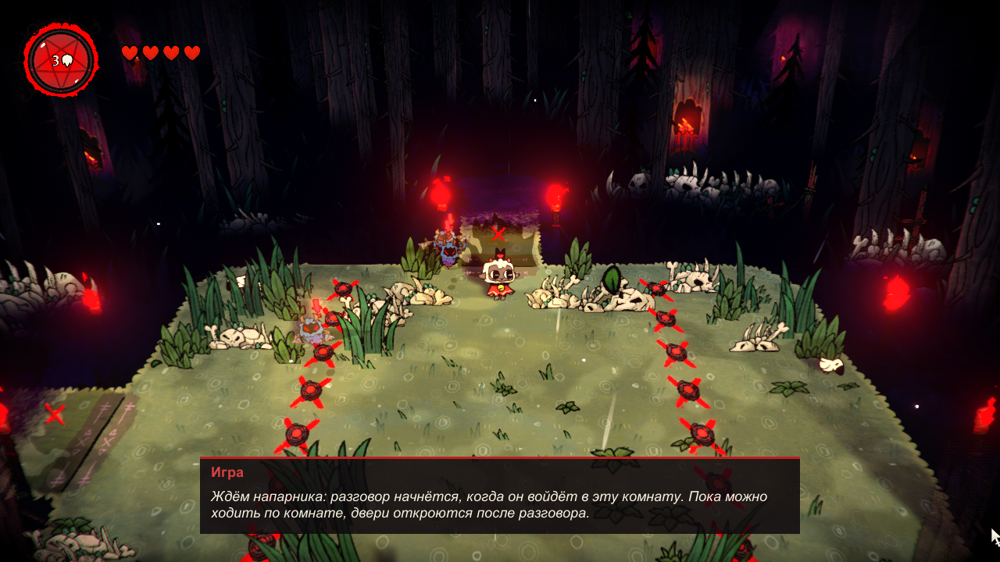

**The HUD as in the game's co-op.** In a dungeon both players' panels stand in the game's co-op
slots, yours first, each with its Lamb or Goat portrait and the glowing outline (the friend's portraits
had none), and the co-op's starting hearts; in the cult each sees their own single panel. Alone, a Goat
gets its panel in the Goat's colours. On the dungeon's minimap each player's head stands on the room
they are in, side by side when in one room.

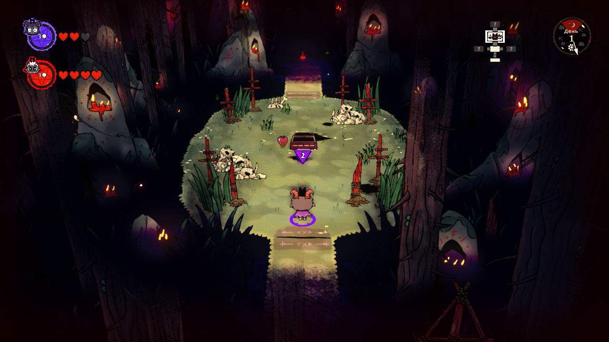
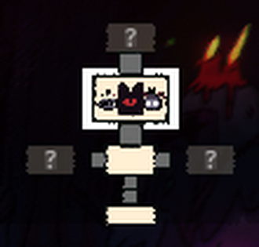

**All 15 languages of the game.** Every line of the mod is in English, Russian, Japanese, French,
German, Spanish, Portuguese (Brazil), Chinese (Simplified and Traditional), Korean, Italian, Dutch,
Turkish, French (Canadian) and Arabic, and follows a language change in the game's settings. The
partner's lines at the bottom of the screen lost TextMeshPro tags they showed as text (`<shake>`) and
their box grows for long lines. Arabic is shaped as the game shapes it; a long Arabic line over
several rows reads its rows in the wrong order (the box can't lay out right-to-left text).

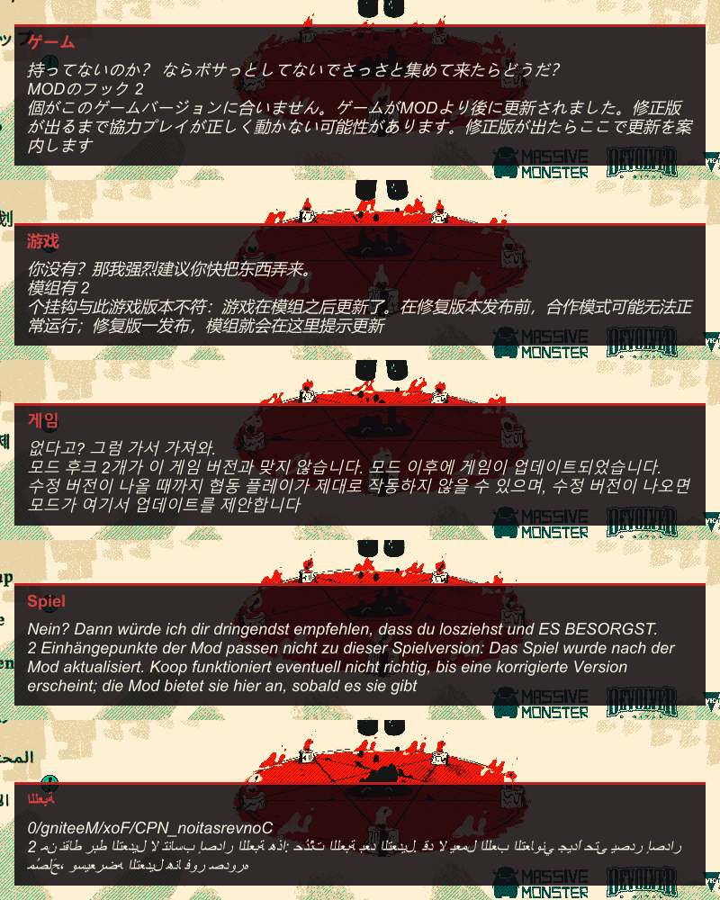

**Fixes.**
- An enemy the room's owner left in mid-jump stayed up in the air for the other player: it lands now,
  and its animations come back.
- Each player has their own tarot cards in a run.
- The friend's story rooms come from the run's creator's run count.
- The connection icon doesn't count the partner's loading as a lost connection.
- "✕ CO-OP ANYTHING" under the game's title in the main menu and on the title screen.

**Cleaned out.** What COTLMP's IP play left and the Steam co-op never runs, about 3,000 lines: the
server browser, join by IP, server passwords, the dedicated server, game modes, the Unity asset bundles
they needed (if one was missing the whole mod stopped), and the settings that did nothing (Game Mode,
Voice Chat, Server Password). The integrated server no longer announces itself on the local network
every 5 s and listens on 127.0.0.1 only: only the player's own game and the Steam bridge talk to it.

**For testers.** The mod counts what goes wrong by kind (its warnings and errors, exceptions in its
patches that only the game's log showed, quiet fallbacks), puts it in the test report and logs the most
frequent at the end of a session. The test harness is in six files by subject; a test step that throws
is logged with its name and counted, and the others go on. New switches: `-cotlmp-droplink=N[,D]`,
`-cotlmp-chattest`, `-cotlmp-badpatch`, `-cotlmp-langshots`.

**Tested:** a 45 s drop-out (back on the 2nd try, things restored), a 300 s one (3 tries, the main
menu with the error), the chat both ways (input off while typing and back), a patch that doesn't fit
(the rest in, the window both ways, the partner's note), the update in the game and a broken one
rolled back, all 15 languages in the partner's line box, the HUD and the minimap heads in a run.
Not tested: real two-account Steam reconnects.

## 0.3.5 (2026-10-25)

**Scenes and films end for both together, as at the opening's crown.** What comes after a scene's
last words (the camera going over the room, a leader getting up) each game played on its own clock,
and films on their own too: whoever was done first got their hands back while the other still
watched, and the leader fought them alone. Now whoever is done first waits: their game stands still
behind a black screen, "Waiting for your partner to finish watching", until the partner's scene or
film is over too (at most 45 s for a scene, 60 s for a film). This is for any scene both play in one
dungeon room (every leader and the scenes rooms start by themselves) and for a story talk both play
anywhere. See `SceneEnds.cs`.

**Films can be skipped.** The game's skip prompt is shown on its films and the skip button skips.
Whoever skips gets the black screen and waits while the partner watches on, so a skip never cuts the
partner's film short.


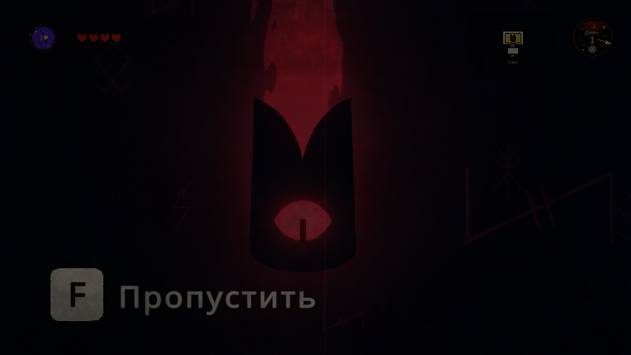

**The host's world first.** The friend who waited goes on only when the host says its game is there
again (its world loaded after the scene or film). If that takes a while, the friend's black screen
says "Waiting for the sync to be confirmed" (at most 30 s).


```
host:   We skip our film Intro, the partner watches on: waiting for them
        Waited 9.7 s for the partner's film: theirs is over too, going on together
friend: Our scene in Dungeon1#1.1.0@0,-1 is over, the partner's isn't: waiting for them
        Waited 4.7 s for the partner's scene: theirs is over too, going on together
        Waiting for the host's game to be there again
        Waited 4.0 s for the host's game: the host's world is up, going on together
```

**Tested:** scene ends both ways, a film skipped by the host and by the friend, the host's word late
by 4 s, the first land's first leader (the friend's scene over 1.6 s first, it waited). Other lands'
leaders go the same way but weren't run.

## 0.3.4 (2026-10-25)

**Leaders' rooms: in together, as the opening's crown.** Whoever comes into a land's leader's room first
waits by the door ("Waiting for your partner to come in") until the
partner comes in, at most 90 s or until the partner is out of the run. When the scene starts for
one of them, the other is taken to where it starts, so it starts in both games at once, as the
game's co-op takes both players into it; its words go at the host's pace (since 0.3.3) and the fight
starts for both together. See `SharedScenes.cs`.

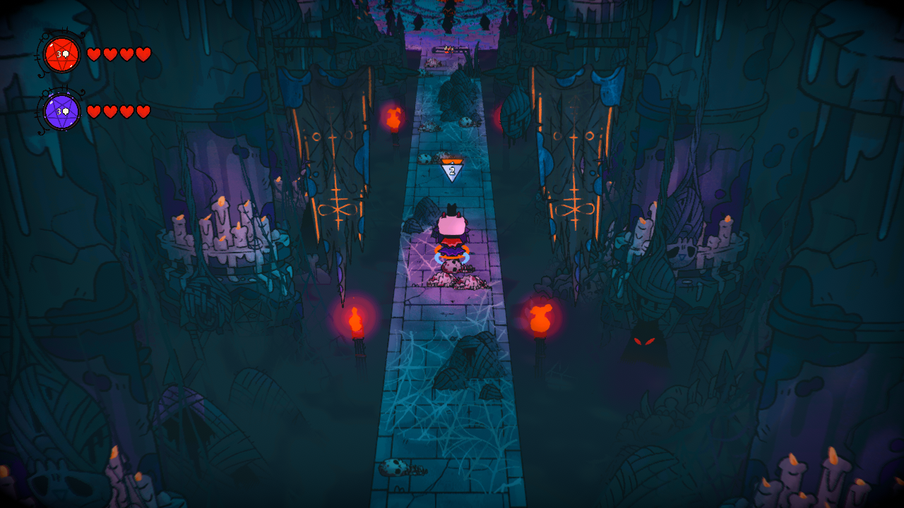

```
[COOP] First into the leader's room Dungeon1#4.1.0@0,999: waiting for the partner at the door
[COOP] The leader's room Dungeon1#4.1.0@0,999: the partner came in, going on together
[COOP] The partner's scene started: going to where it starts          (the friend)
[COOP] The host leads the conversation in Dungeon1#4.1.0@0,999 (2 lines)
both:  the scene over at the same second, the fight on
```

**Fixed: both down, but the host stood on.** The friend fell while getting the downed host up: the
friend's run was over, but the host's game, trying to end its run too, let the life loop call it
alive again and its last hit didn't take, so the host stood with a frozen revive bar and the
friend's hearts full. Now nothing stands a lamb up meanwhile, a last hit that doesn't take goes the
game's own way to game over, and a fallen partner's revive bar and hearts empty.

```
host:   We are Down -> The partner is Dead -> Both of us are down, the run ends
        -> The last hit didn't take, ending the run the game's way -> We are Dead
friend: Falling while getting the partner up -> We are Dead
```

**Tested:** the first land's leaders' rooms of the first and fourth layers (the test now goes straight
there, the friend 15 s late). The other lands' leaders go the same way but weren't run.

## 0.3.3 (2026-10-25)

Fixes for what came up in the first game on two real Steam accounts.

**Fixed: the hearts and stats panel went blank.** The partner's lamb is a second lamb in the game's
player list, so the game builds its two-player HUD; but it was always "the Lamb", took the Lamb's
panel, and as it was made again on every room change the HUD was rebuilt around it, and the
two-player panels were only brought on screen in the game's own local co-op. Only for a moment after
a load did ours show. Setting itself up it also reset the save's blue, black and spirit hearts in a
dungeon. Now both panels show as in the game's co-op: the Lamb's in red, the Goat's in purple with
the Goat's icon, each with its own player's real hearts (sent with the partner's moves). See
`CoopHud.cs`.

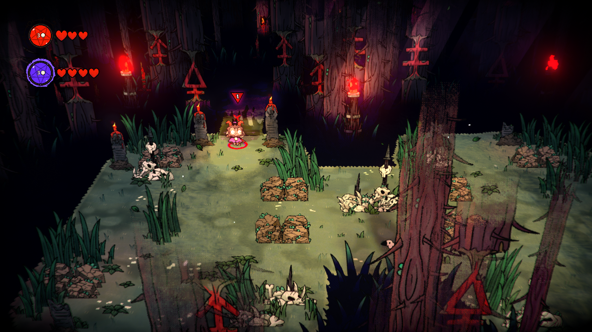
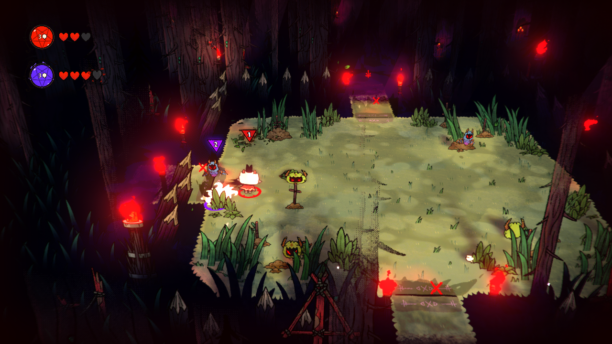

**Both crowns on the map between floors.** The partner's crown stands on their stop, the eye and the
co-op ring in their colour (the Lamb's red, the Goat's purple), and a small faint crown of theirs on
the way they are pointing at. See `MapCrowns.cs`.

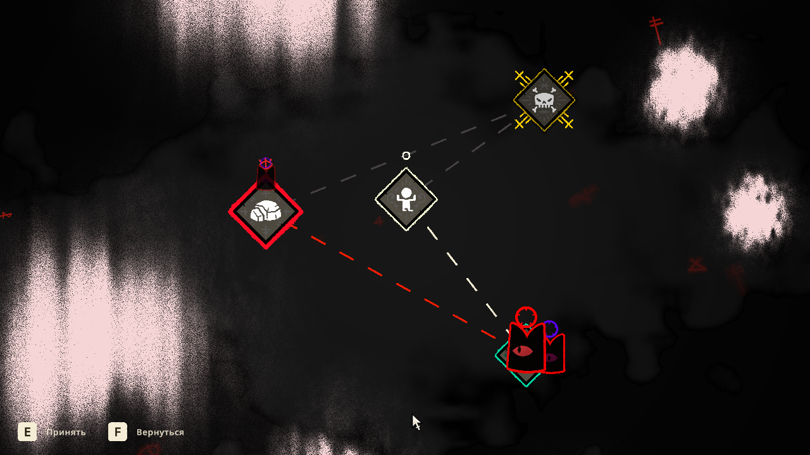

**Fixed: enemies gone before the follower's altar in the opening.** The opening's stops, and a
dungeon's resource and follower stops, keep the floor number of the floor before, so their rooms had
the same names as rooms already cleared: a room counted as cleared and lost its enemies, and the
follower's altar never started. A room's name now carries the stop of the run's map:

```
before: [COOP] Game Biome Intro#1.1@0,0 was cleared by the partner, opening it   (the follower's stop)
now:    Dungeon1#1.1.0@0,0 ... Dungeon1#1.1.1@-1,0 ... (the way taken on the map is part of it)
```

**Fixed: the same follower twice.** A newcomer waits at the gate in both games with the same id; when
one player recruited it, it came to the other's cult and stood next to the newcomer still waiting
there, which could be recruited again. Now the one who starts recruiting has it (the other gets
"Someone is already talking to this follower") and the waiting copy goes when the follower comes. See
`CultRecruits.cs`.

```
[COOP] The partner is recruiting follower 3
[QA client] Recruit test: we try to talk to it while the host recruits: refused
[COOP] Follower 3 was recruited by the partner: our newcomer goes
[QA client] Recruit test: follower 3: 1 in the cult, 0 waiting, 1 listed, 0 newcomers
```

**Scenes go at the host's pace.** A conversation both games play in one place (a boss's words before
the fight, the story's talks) is one scene, as in the game's co-op: the friend's copy follows the
host's lines, takes the host's answer and ends with the host's, so what comes after (a boss waking up)
starts in both games together. A talk only the friend has is the friend's after a few seconds. See
`SharedScenes.cs`.

```
[COOP] The host leads the conversation in Dungeon1#1.1.0@3,0 (4 lines)
[COOP] The host answered 1, so do we              (the friend tried to rush it and pick answer 0)
[QA client] Scene test: over after 3.7 s, answer 1
```

**The partner's loot.** What the partner breaks (pots, grass, trees, rocks, berry bushes) drops its loot
on your screen too, and it flies to the partner; it is theirs, never yours. See `GhostLoot.cs`.

**Not tested yet:** the Leshy fight itself with the new scene pacing (the automated test has no way
to the boss yet), the first follower's whole tutorial after a real opening.

## 0.3.2 (2026-10-24)

**Fixed: bruises and the black eye.** The game dresses the lamb by its hearts in a dungeon: bruises
at two hearts or less, a black eye at one (and black and white when there is no faith left for a
curse, and the mop of its chore level). The partner's puppet only wore the fleece and the weapon, so
it always looked unhurt. Now each game sends how it dressed its own lamb with its moves, and the
puppet wears the same. See `Appearance.Look` and `PuppetSync.cs`.

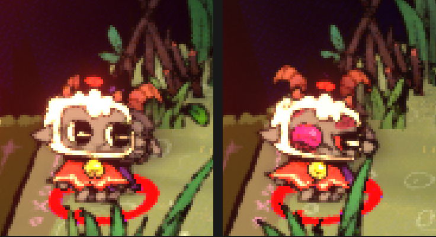

```
[QA host] Hurt test: our hp 2, our look 101          (bruises)
[QA host] Hurt test: our hp 1, our look 102          (black eye)
[QA host] Hurt test: our hp 6, our look 100
[QA client] Hurt test: player 0's puppet looks 101 (bruises 1)
[QA client] Hurt test: player 0's puppet looks 102 (bruises 2)
[QA client] Hurt test: player 0's puppet looks 100 (bruises 0)
```

**Tested: the friend's sermon and ritual in a real temple.** The host builds a temple; the friend goes
in, preaches a sermon (with the game's first-sermon tutorial and its upgrade) and holds a holiday.
The followers gather in the friend's game and go back to the host's after. On the host's side: the
sermon's day, the followers' devotion and thoughts (watched a sermon, holiday), the holiday and its
cooldown, the 75 bones it cost, and faith that moves the same on both sides.

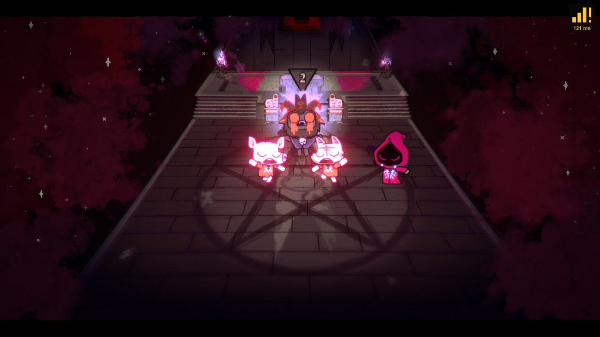

```
[QA host] Temple: sermonday=1 day=1 holiday=True cooldown=0.90 bones=25 adoration=30.0
          thoughts=3:WatchedSermon+DanceCircleLed+BadChat,4:WatchedSermon+Holiday+...  hands=0
```

**Fixed: the grass of the first runs.** A room's grass rolled the same in both games, but its odds
come from the save: the first three runs have plain grass in the first land, and a flower quest or few
flowers in the inventory raise the flower odds. Two saves apart by a run grew different rooms (plain
grass for one, flowers for the other). Whoever starts a run now sends those numbers with it and both
games grow the run's grass from them. See `RunGrass.cs`.

```
[COOP] Starting run 1733995097 in Dungeon1_1 (run count 2)
[COOP] Joining the partner's run 1733995097 in Dungeon1_1 (their run count 2, ours 11)
before: the same room, host plain grass 14/0/0, friend 0/21/0; now both plain grass
```

**Fixed: a follower's quest talk starting on the friend's side.** Every half a minute the game picks a
follower to come up with a quest or a story talk (the first follower's tutorial talks too). The
friend's game picked its own, at random, and told the host's game about it as cult data. Now the host's
game picks for both; either player can take the talk, as with any follower.

**Checked again:** enemies of the room's owner go for both players and hit the partner through the
network (in the test: 11 hits on the friend's puppet, 5 taken by the friend), and the partner's puppet
at a door takes nobody along (since 0.2.0).

**Not tested yet:** two real Steam accounts.

## 0.3.1 (2026-10-24)

**Fixed: the night fox with both players there.** Each game had its own fox, so both players could
start a talk with it at once, the deal counted in one game only, and the place and the talk went apart.
A deal with the fox changes the save (what it takes, what it gives), and the save is the host's, so
now the host makes it: the friend gets "The host makes deals with the fox". When the host talks to
it, the friend's fox comes out of the dark as the host's does, the talk and its answers show at the
bottom of the friend's screen, and the outcome (the fox's encounter, its introduction, the place it
is done with) is the friend's too. See `FoxSync.cs`.

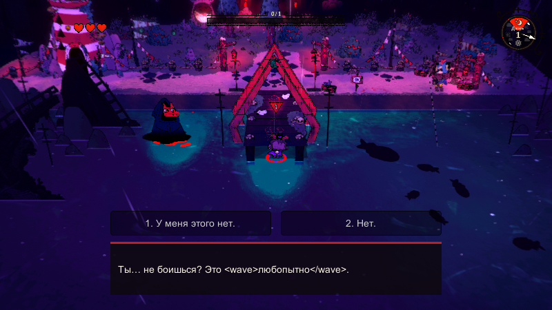

```
[QA client] Talking to the fox                       (refused: the host makes deals with the fox)
[COOP] Talking to the fox in HubShore                (the host)
[COOP] The host's fox talk in HubShore starts        (the friend's fox comes out)
[COOP] The host's fox talk in HubShore is over (done there: False)
[QA client] Fox after: encounter=0 done= intro=HubShore
```

**Fixed: the shared opening after the crown ran as "no run".** Both games took a run numbered 0,
which the mod treats as none, so part of what is shared in a run (who joined it, what to send on a
rejoin) didn't work there. Now each starts its own, and at the crown the friend takes the host's:

```
[COOP] Taking the partner's run -301648455 (ours was 897309048)
[COOP] Room Game Biome Intro#1.1@0,0 cleared in run -301648455 (ours -301648455)
```

**Fixed:** the game's text animation tags (`<wave>` and the like) showed as text in the partner's
conversation at the bottom of the screen.

## 0.3.0 (2026-10-24)

**A lobby in the main menu**
- The main menu's Multiplayer button opens an online menu built from the game's own menu (its header,
  buttons, highlight and fonts, on its canvas), in place of the old server browser: **Create Lobby**,
  and the friends who have a lobby open. See `OnlineMenu.cs`.
- Create Lobby shows the game's own save slots: a save, or an empty slot for a new game (with the
  game's new game options). The lobby opens online play; the Lamb of the menu's key art steps aside for
  the Goat (a copy of it in its goat skin), and each wears its player's Steam name and avatar. The Goat
  is faint until a friend stands in the lobby. **Invite a Friend** opens the Steam overlay; **Play**
  starts both. See `Lobby.cs`.

  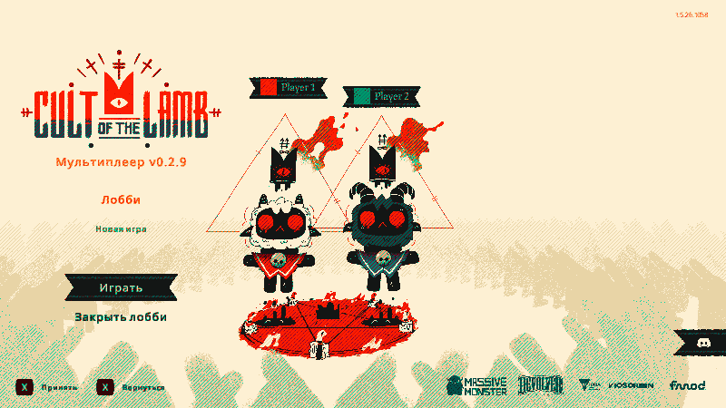
  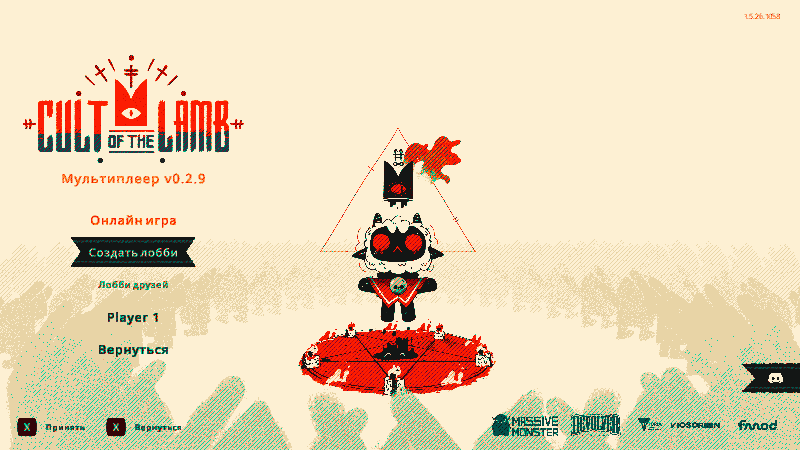
  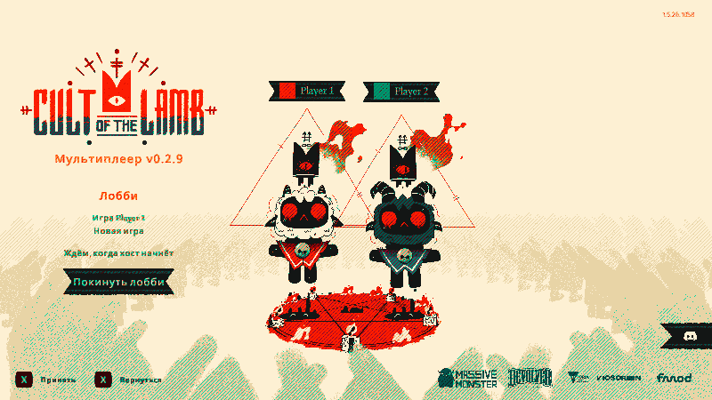

- It scales with the game: checked at 800x450, 1024x768, 1680x720 and 1920x1080 (on a narrow screen
  the two stand closer).

  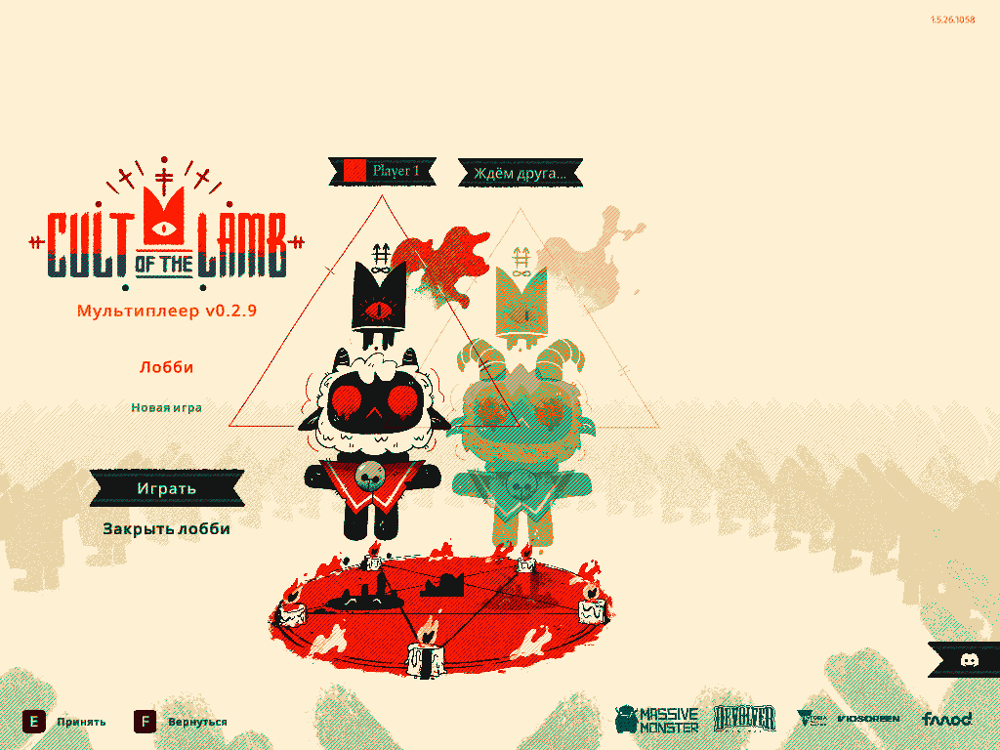
  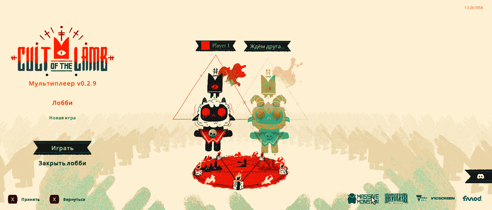

**A new game together**
- Play on a new game: each player plays the opening alone, the Lamb led to the altar in chains, until
  the One Who Waits gives the crown. Whoever has it first waits; then both come back to life at once in
  the same place, the friend as the Goat, and the rest of the opening is a shared run. On its way to the
  cult the friend's game takes the host's save, as for any join. The friend's own opening is never
  saved. See `IntroCoop.cs`.

  
  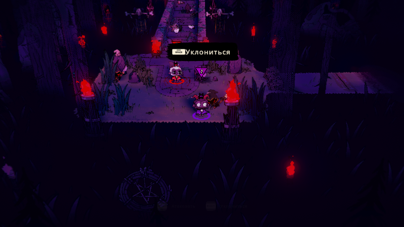

- Tested on two copies, the crown reached by a shortcut and the end of the opening by a jump to the
  cult:

  ```
  [LOBBY] Play: NewGame with 1 friend(s)
  [INTRO] We have the crown, the partner not yet
  [INTRO] The partner has the crown, going on together
  [INTRO] The opening is over: into the host's cult, on its save
  [COOP] Got the host's save (4102 bytes, 0 followers), going to its cult
  ```
- On a save: Play loads it on the host; the friend's request for the save waits until the host's game
  is up, then the friend goes to the cult.

**Also**
- English and Russian for everything new, and for the last texts of the mod that were English only
  (opening online play, a different game version).
- The release's README is in English too.

## 0.2.9 (2026-10-24)

**Both players' mod versions compared on joining**
- The joining player and the host send their mod versions. If they differ, the joining player sees
  both, "Host's version" and "Your version", before the host's save is loaded. Playing on is allowed,
  with a warning that different versions may cause errors or damage the save. See `VersionCheck.cs`.
- The host on a newer version: **Update** takes exactly the host's version (its release by tag), the
  game restarts and joins the host again by itself.
- The host on an older version: **Ask the host to update** sends the host a window with both versions;
  the host updates to the friend's version, the game restarts, and the host opens the game online
  again and picks the save.
- The host hears of a friend on another version as a short note. If updating doesn't work, the join
  goes on and the release page is offered.

  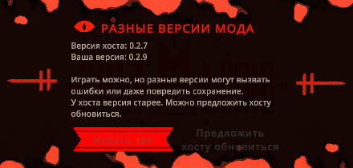
  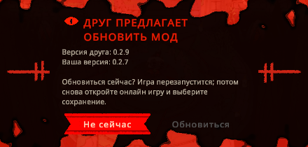

- Tested on two copies: the friend updated to the host's (fake) newer release, restarted and joined
  again by itself:

  ```
  [COOP] Mod versions differ: the host's 0.2.10, ours 0.2.9
  [COOP] Mod versions differ, the joining player chose: update
  ... the installer waits, installs, starts the game again ...
  [UPDATE] Updated to the host's version, joining host 1 again
  [STEAM] Joined host 1 in scene Main Menu
  [COOP] Got the host's save (4192 bytes, 0 followers), going to its cult
  ```

**Fixed:** the installer started by the mod inherited the game's open sockets and files, and so did
the game it started again (that game couldn't open its connection); it is now started through the
shell. A host now answers every join with its version, not only the first one of a session.

**Known:** Windows Smart App Control can block a new installer it doesn't know yet (the installer
isn't code-signed); then the mod offers the release page.

## 0.2.8 (2026-10-24)

**The mod updates itself**
- Once a game start the mod asks GitHub for the latest release. If it is newer, the main menu offers
  it in the game's own window. Taking it downloads the release's installer, checks it against the
  SHA-256 GitHub gives for it, closes the game, installs the new version and starts the game again
  with the same launch options. If anything fails, it offers the release page instead. See
  `COTLMP/Network/Updater.cs`.

  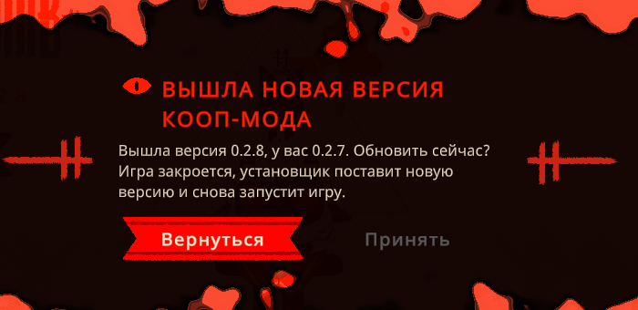

- The installer checks too: an older installer offers the newest one, downloads it, checks it and
  starts it for the same folder. New switches: `--wait <game process>` and `--relaunch`, used by the mod.

  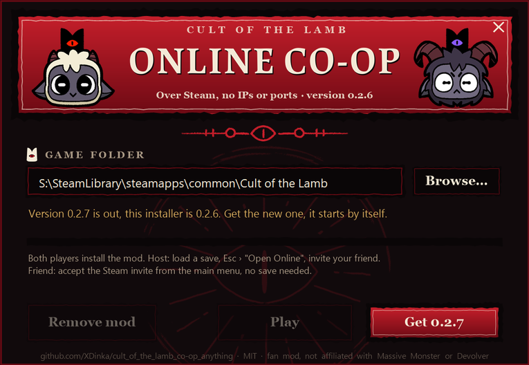

- Tested end to end on a test copy (a fake release 0.2.8 offered to a mod that took itself for 0.2.7):

  ```
  [UPDATE] Latest release 0.2.8, this mod 0.2.7: an update is offered
  [UPDATE] Installer 0.2.8 (9db8ca0d...) started, closing the game for it
  ... the installer waits, installs, starts the game again ...
  [UPDATE] Started again after taking 0.2.8
  ```

**Fixed on the way:** a game started again by the installer from a modded game came up without mods
(BepInEx's loader marks are inherited through the environment); the mod and the installer clear them.

**Note:** the self-update needs the new installer on the release it takes, so it works from 0.2.8 to
the next version on. From 0.2.7 to 0.2.8, update once with the installer as before.

## 0.2.7 (2026-10-24)

**Fixes**
- Items duplicated in the cult: a pickup was counted twice, by the shared pickups made for dungeons
  and by the cult's one inventory. In the cult only the inventory counts it now; the shared pickups
  just take the other side's copy off the floor.
- Items could get lost: the host's inventory arriving at the friend's overwrote what the friend had
  picked up and not sent yet. That now stays and goes with the friend's next look.
- What the friend's game changes on its own at a new part of the day (the weather's timing) is no
  longer sent to the host as the friend's doing.

**A sync check on top of the sync**
- Every 4 s the owner of a part of the cult (the host, or the friend for the followers in their hands)
  sends one hash per group: followers, structures, the cult's data, the inventory. The other side
  hashes its own, 2 ms a frame at most; a group that differs gets the owner's list of hashes per
  object; an object that still differs on the next check is asked for, and the owner sends it whole
  or says it's gone. Changes still on their way differ once and aren't touched. See `CultCheck.cs`.
- Every fix is logged with what differed. From the test, after a rename, the sermon day, 3 stone and
  a torch were lost on the way on purpose:

  ```
  [COOP] Sync check 22: F3 Differs, S96 MissingHere, S97 ExtraHere, D291 Differs two checks in a row, asking the host
  [COOP] Sync check: F3 differed from the partner's in _name, took theirs
  [COOP] The partner built DECORATION_TORCH (96)
  [COOP] The partner's DECORATION_TORCH (97) is gone, ours too
  [COOP] Sync check: the cult's data differed from the partner's in PreviousSermonDayIndex, took theirs
  ```
- It also found real differences: a follower arriving at the friend's had its needs (hunger, rest,
  social) and clothes set by the friend's game when it appeared; now fixed by the check.

**Load, measured and lowered**
- Once a minute the log says what the sync cost: milliseconds a second, the worst frame, KB/s, the
  game's garbage collections, checks and fixes; a frame over 50 ms is logged with what it was doing.
- Simple cult data (numbers, flags, text) is compared without packing it, and structures and the
  cult's data are looked at every other second: from about 11 to 3.3 to 4.4 ms of work a second
  (~0.06 ms a frame), the worst frame from 6 to 22 ms down to 2.5 ms, about 0.5 KB/s. The 230 to 270 ms
  frames were garbage collections landing in the sync's work; none since.

  ```
  [COOP] Cult sync, last minute: 3.45 ms a second, worst frame 2.41 ms, 0.47 KB/s sent, 1 garbage collections in the game; checks 64 sent, ...
  ```

**Seen in the game:** the host chops a tree; this is the friend's screen (the host is the Lamb by the
tree, the tree goes down to its stump):

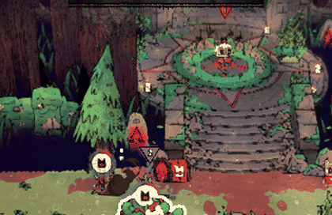

**Known:** on a new save the game's own first-follower conversation also starts on the friend's side
for a moment; to be fixed with the shared opening in 0.3.0.

## 0.2.6 (2026-10-24)

**The friend's hands in the cult**
- A follower the friend talks to, or that the friend's temple gathers for a sermon or a ritual, runs in
  the friend's game for that while; the host's copy stands still and shows what it does there. When the
  friend's game is done with it, it goes back to the host's game, which carries on from the orders it
  got (sleep, a job, a meal, prison). So the friend's commands, sermons and rituals now take effect in
  the host's world. See `CultHands.cs`.
- One player talks to a follower at a time: the other gets "Someone is already talking to this
  follower".
- The rest of the cult's data is shared too: doctrines, rituals done and their cooldowns, faith and
  the hunger bar, the day of the last sermon, quests and the like (DataManager, member by member).
  What is each player's own (hearts, looks) or a run's stays apart, and what a run changed isn't sent
  back to the cult.
- Followers move between places (the temple and the cult) on both sides as the game moves them.
- A changed outfit or necklace shows on the other side at once.

**Fixes**
- Trees, rocks and berry bushes: every hit shows for the player who watches as it lands (shake,
  progress bar, the stump, smoke and sound), not a jump once a second and then a vanished tree.
- A rock broken by the other player no longer drops a second lot of stone for the one who watched.
- New followers and structures no longer flicker in and out: an object that arrived from the partner
  while the cult was being compared was taken as lost, and went back and forth (also in 0.2.5).
- No interaction prompt over the other player's head: their puppet no longer looks for things to use.

**Not tested yet:** a real sermon and ritual in a temple (the automated test's cult has no temple; the
gathering itself is tested), and two real Steam accounts.

## 0.2.5 (2026-10-24)

- One cult for both: the host's game runs it (followers, structures, time); the friend's game shows it.
  Followers walk and animate as the host's, new and gone followers and structures appear and go, the
  inventory is shared. What the friend builds, removes, spends or changes reaches the host.
- The old time sync (the joining player's clock running faster or waiting) is gone: the clock is the host's.

## 0.2.4 (2026-10-24)

- The friend plays on the host's save, as in the original co-op: joins from the main menu without a
  save of their own; leaving takes them back to the main menu and the host's save is forgotten.
- A room the partner cleared opens even if its doors shut on you; a shut room with no enemy left opens
  after 8 s.
- Cleanup: the host's reward pools, crash recovery and the pause menu guard went.

## 0.2.3 (2026-10-24)

- Dialogs: whoever talks answers, as in local co-op; the other player sees the choices.
- Player list in the pause menu (icon, Steam name, host, ping).
- No online play in the prologue, as the game keeps local co-op out of it.

## 0.2.2 (2026-10-24)

- Pause menu works in the opening, before the crown.

## 0.2.1 (2026-10-24)

- Russian strings for the mod; the button is "Open Online" / «Онлайн игра».
- Accepting a friend's invite while hosting alone joins the friend.
- The installer and the README in the game's style.

## 0.1.x (2026-10-22 to 2026-10-23)

- Online co-op over Steam on top of COTLMP: invites, the Lamb and the Goat, shared dungeon runs (same
  floors and rooms, room owners, shared enemies, loot and kills), knockout and revive, partner
  animations, the map between floors, tarot readings, broken things, a bad connection icon, the installer.
