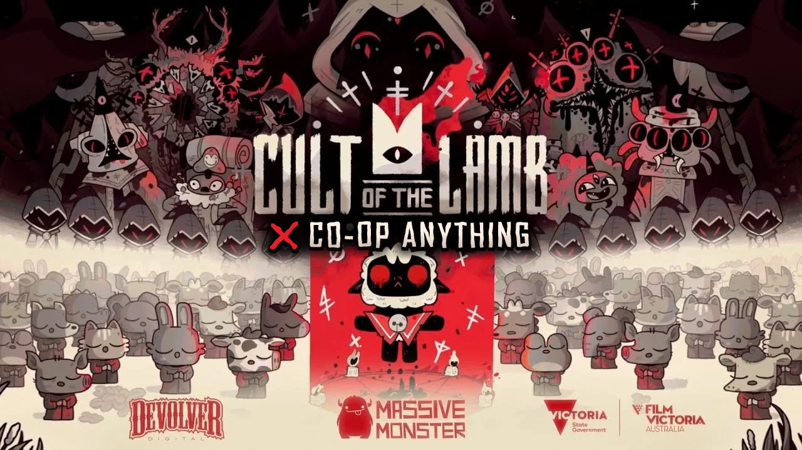
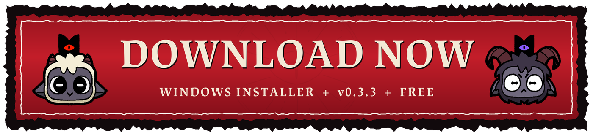
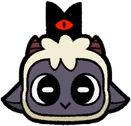
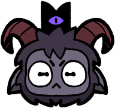
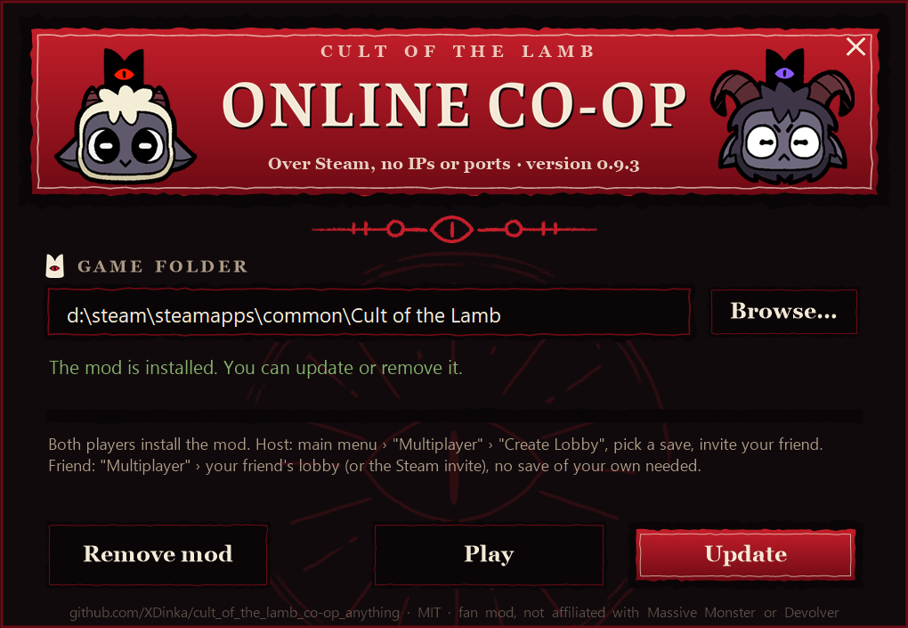
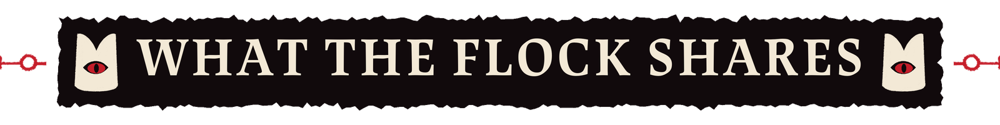

<p align="center">
  
</p>

<p align="center">
  <a href="https://github.com/XDinka/cult_of_the_lamb_co-op_anything/releases/latest/download/CotlCoopInstaller.exe"></a>
</p>

<p align="center">
  <b>Online co-op for Cult of the Lamb over Steam.</b><br>
  <a href="https://github.com/XDinka/cult_of_the_lamb_co-op_anything/releases/latest">Release zip and notes</a> · <a href="#по-русски">По-русски</a> · <a href="CHANGELOG.md">Changelog</a> · <a href="LICENSE">MIT</a>
</p>

<p align="center"><sub>Fan-made mod, not affiliated with or endorsed by Massive Monster or Devolver Digital.</sub></p>

# Cult of the Lamb Co-op Anything

**Version 0.3.3, pre-release.**

You invite a friend through the Steam overlay. As in the game's own co-op, the friend plays in your
game: they join from the main menu, no save of their own needed, and play on your save (nothing of it
is written on their side, their own saves stay as they were). You see each other in the cult and on
dungeon runs. Dungeon runs are shared: same floors, same rooms, and
damage to enemies counts on both sides.

> **Pre-release 0.3.3.** Tested with two copies of the game on one PC and a loopback stand-in for
> Steam, including a simulated bad connection. Real two-account Steam play has not been tested yet.
> Expect bugs, and back up your saves.

Based on [COTLMP](https://github.com/GeoB99/COTLMP) by GeoB99, Neco-Arc and contributors (MIT),
which provides the player puppets, the UDP protocol and the integrated server.

<p align="center"></p>

<p align="center"></p>

## Playing

<table>
<tr>
<td width="96" align="center"><br><sub><b>Host</b></sub></td>
<td>Main menu: <b>Multiplayer</b>, <b>Create Lobby</b>, pick a save (or an empty slot for a new game
together), <b>Invite a Friend</b>, then <b>Play</b>. Or, in your game: <b>Esc</b>, <b>Open Online</b>.
You play as the Lamb.</td>
</tr>
<tr>
<td width="96" align="center"><br><sub><b>Friend</b></sub></td>
<td>Main menu: <b>Multiplayer</b>, then your friend's name under "Friends' lobbies" (or accept the
invite). You stand in the lobby until the host presses Play. You play as the Goat, as in the game's own co-op.</td>
</tr>
</table>

1. **Both players** [download `CotlCoopInstaller.exe`](https://github.com/XDinka/cult_of_the_lamb_co-op_anything/releases/latest/download/CotlCoopInstaller.exe), close the game and press **Install**.
   It finds the game in Steam, backs up what it replaces, and **Remove mod** puts it back. Windows may
   warn about an unknown publisher: "More info", then "Run anyway". Without the installer:
   `install.cmd` from the [release zip](https://github.com/XDinka/cult_of_the_lamb_co-op_anything/releases/latest).
2. The host opens a lobby and invites, the friend joins it (see above), the host presses Play. On a
   new game each of you plays the opening alone until the crown; whoever gets it first waits, then you
   come back to life together and go on to the cult as one. Accepting an invite while your own game is
   open online with nobody in it closes yours and takes you to the friend.
3. Dungeons: the **host enters the dungeon first** and the friend follows within 10 minutes, through
   the same door. Then you both get the same run. Each of you walks the floor freely; enemies are
   shared in a room you are both in.

<p align="center"></p>

<p align="center"></p>

## What works

| Feature | State |
|---|---|
| Join through Steam (invite, "Join game", `+connect_lobby`) | works on loopback, real Steam: lobby and messaging checked, two accounts untested |
| See the other player: walking, scene changes, and every animation they play (attacks, dodges, spells, hits, knockouts) with their weapon | works in the automated test (attack animations repeated on the puppet) |
| The other player shows up in a room only once it has loaded for them, already in their look | works in the automated test |
| Lamb and Goat, like local co-op (setting "Character": Auto / Lamb / Goat), with the co-op 1/2 indicators | works |
| Shared dungeon layout (same seed for both players' run) | works in the automated test |
| Room owner: whoever enters a room first runs its enemies, the other player's enemies follow them | works in the automated test |
| Enemies attack both players, hits on your lamb come from the owner's game (a dodge in time still saves you) | works in the automated test |
| Shared enemy health and kills | works in the automated test |
| Shared pickups: what one picks up, both get | works in the automated test |
| Knocked out instead of dead while the partner fights on; stand next to them for 3 s to revive, or clear the room | works in the automated test |
| Game over only when both are down | works in the automated test |
| The map between floors is the host's for both; either player picks the way, whoever picks first, and the other is taken there. The next floor gets the same seed | works in the automated test (two floors, the joining player picked, the host followed) |
| Each player walks a floor on their own (the partner's puppet at a door takes nobody along); rooms one player opened show on the other's minimap | works in the automated test |
| Rooms one player cleared are cleared for the other (no second fight), wounds and kills carry over | works in the automated test |
| The partner's conversations show at the bottom of your screen; your camera and your lamb stay yours | works in the automated test |
| Dialog choices: whoever talks answers, as in the game's co-op; the other sees the answers and can point at one, the game's co-op icons (red Lamb, blue Goat) show which answer each player is on | works in the automated test (both directions) |
| The pause menu lists the session's players: co-op icon, Steam name, host, ping | works in the automated test |
| A lobby in the main menu, in the game's own look: the host opens it on a save or a new game, friends' lobbies are listed, the Lamb and the Goat stand on the menu's altar with each player's Steam name and avatar; Play starts both | works in the automated test (a save and a new game, 1024x768, 800x450, 1680x720, 1920x1080) |
| A new game together: each plays the opening alone until the crown, whoever gets it first waits; then both come back to life at once (the friend as the Goat) and the rest of the opening is shared; on the way to the cult the friend takes the host's save | works in the automated test (the crown reached by a shortcut, the opening's end by a jump to the cult) |
| An invite accepted during the host's prologue waits for the host's cult | not tested in the prologue itself |
| The night fox: the host makes its deals; with both there, the friend sees the fox come out and the host's talk, and the outcome counts for both | works in the automated test (on the shore at night) |
| Enemy attacks of the room owner (shots incl. homing, beams, bombs, warning circles, other pooled attacks) show for the other player and move exactly as the owner's | works in the automated test (forced shots) |
| Rewards roll from the host's unlocks (weapons, curses, tarot, relics) for both, without touching the joining player's save | works in the automated test (tarot: host 85 cards, joiner 15, same draws) |
| Chests, weapon/relic podiums, tarot draws and interactions roll the same for both; each player opens and picks on their own | chests checked in the automated test |
| The tarot reader in a dungeon deals both players the same two cards | works in the automated test |
| One cult for both: the host's game runs it (followers, structures, time), the friend's shows it: followers walk and animate as the host's, new and gone followers and structures appear and go, the inventory is shared | works in the automated test (wood, stone, a bed, a torch, a new follower, a removed bed, both ways) |
| What the friend does in the cult reaches the host: building, removing, items gained or spent, changes to followers and structures (as data) | works in the automated test (a renamed follower, a built torch, a removed bed) |
| Rooms come up with the same grass, bushes and breakable decorations (barrel, crate or bone pile) for both, also when the two saves have had a different number of runs or flowers | works in the automated test (saves 1 and 10 runs apart) |
| The partner's lamb shows its bruises and black eye (two hearts or less, one heart), black and white without faith, and its mop | works in the automated test (both ways, also from real enemy hits) |
| Both players' hearts panels as in the game's co-op: the Lamb's in red, the Goat's in purple, each with its player's real hearts | works in the automated test |
| The map between floors shows both crowns (where each stands, where each points) in the Lamb's red and the Goat's purple | works in the automated test |
| A conversation both games play in one place goes at the host's pace: lines, answer and end are the host's | works in the automated test (a boss fight not tested yet) |
| A newcomer at the gate is recruited once: the other player's copy waits, then goes | works in the automated test |
| What the partner breaks drops its loot on your screen too, flying to the partner | works in the automated test (trees, rocks, grass) |
| Grass, bushes, pots, barrels, rocks, critters and enemy bodies broken by either player break for the other, also in rooms entered later | works in the automated test (both players cutting at once) |
| The friend's hands in the cult: a follower the friend talks to, or gathers for a sermon or ritual, runs in the friend's game for that while and goes back to the host's with its orders (sleep, a job, prison); one player talks to a follower at a time | works in the automated test (an order to sleep; in a temple the test built, the friend preaches a sermon and holds a holiday, and the host's cult gets its outcome) |
| The cult's data: doctrines, rituals and their cooldowns, faith, the last sermon's day, quests; not what is each player's own or a run's | works in the automated test |
| Mod versions compared on joining: both shown, playing on allowed with a warning; a friend behind updates to the host's version and joins again by itself, a host behind can be asked to update | works in the automated test (both ways, the friend's update end to end) |
| The mod updates itself: a newer release is offered in the main menu, downloaded, checked (SHA-256), installed and the game started again; the installer offers a newer installer too | works in the automated test (a fake release, end to end) |
| A sync check every 4 s: what still differs two checks in a row is taken from its owner (the host, or the friend for followers in their hands) and logged with what differed; once a minute the log says what the sync cost | works in the automated test (a lost rename, sermon day, stone, a missing and an extra torch all fixed) |
| Trees, rocks and berry bushes: each hit shows for the player who watches (shake, bar, stump, smoke), the loot drops only for the one who hit | works in the automated test (a tree chopped, a rock broken, followers picking berries) |
| The friend plays on the host's save: joins from the main menu without a save of their own; leaving (or the host stopping) takes them back to the main menu and the host's save is forgotten | works in the automated test (join, leave, join again) |
| The host keeps playing their own game when the friend leaves or they stop hosting | works |
| A room whose fight ended stays open: a room the partner cleared opens even if its doors shut on you, and a shut room with no enemy left opens after 8 s | works in the automated test |
| Bad connection icon: ping 120+ ms yellow bars, 200+ ms red; packet loss 5 %+ (15 %+ red); unplugged cable when the partner stops answering | works in the automated test (simulated bad connection) |
| Holds up on a bad connection: 5 % loss, 80±40 ms delay, 4 s drop-outs every 25 s, floods of large and many small messages | works in the automated test (200 s dungeon run, no disconnects, 0 errors) |

<p align="center"></p>

## Requirements

- Cult of the Lamb on Steam for both players, version **1.5.26** (Steam build 25223484).
- [BepInEx 5.4.23.5](https://github.com/BepInEx/BepInEx/releases/tag/v5.4.23.5) and
  [COTL API 0.3.4](https://github.com/xhayper/COTL_API/releases/tag/v0.3.4).
  The release zip contains both and an installer.
- A save on the host's side. The friend needs none: they join from the main menu.

<p align="center"></p>

## По-русски

Версия 0.3.3, предрелиз.

Онлайн-кооператив для Cult of the Lamb через Steam. Как в обычном кооперативе, друг играет в вашей
игре: заходит из главного меню, своё сохранение ему не нужно, играет на сохранении хоста (у него оно
не записывается, его собственные сохранения не трогаются). Вы видите друг друга в культе и в забегах. Подземелье общее: враги одни на двоих и атакуют обоих, лут
получают оба, павшего друга можно поднять (постоять рядом 3 секунды) или зачистить комнату.
Хост выглядит Ягнёнком, друг Козлом, как в оригинальном кооперативе. Установка: [скачайте `CotlCoopInstaller.exe`](https://github.com/XDinka/cult_of_the_lamb_co-op_anything/releases/latest/download/CotlCoopInstaller.exe) у обоих игроков (или `install.cmd` из релизного архива).
Хост: в главном меню «Мультиплеер», «Создать лобби», выбрать сохранение (или пустой слот для новой игры вдвоём),
«Пригласить друга», потом «Играть». Друг: «Мультиплеер», имя друга в «Лобби друзей» (или принять приглашение).
В лобби стоят Ягнёнок и Козёл с именами и аватарками из Steam. В новой игре каждый проходит пролог сам до короны,
кто получил её первым, ждёт; дальше оба оживают вместе и идут в культ. Из своей игры по-прежнему можно открыть
онлайн: Esc, «Онлайн игра». В подземелье хост заходит первым, друг идёт следом через ту же дверь.
Если связь плохая, в правом верхнем углу появляется значок: три палочки с восклицательным знаком
(пинг от 120 мс жёлтые, от 200 мс красные), пакеты с пропущенным (потери от 5 %) или выдернутый кабель
(друг не отвечает).
Культ общий: последователи, постройки, ресурсы, доктрины, ритуалы и время у обоих как у хоста, что строит или тратит друг, видит и хост.
Раз в 4 секунды игры сверяют культ по хэшам и чинят расхождения, каждое пишется в лог. С последователем говорит один игрок; последователь, с которым говорит друг или которого он собрал на проповедь или ритуал, на это время живёт в игре друга, а потом возвращается к хосту с его приказами.
Карты у гадалки одинаковые, сломанная трава, горшки и камни ломаются у обоих.
Карта между этажами общая (карта хоста): кто первым выбрал путь, туда идут оба. По этажу каждый
ходит сам, комнаты, где побывал партнёр, открываются и на вашей мини-карте. Удары, перекаты и
заклинания партнёра видны как у него, а появляется он в комнате, только когда она у него загрузилась. В диалоге отвечает тот, кто говорит, как в обычном
кооперативе; второй видит варианты и может указать на один (значки красного Ягнёнка и синего Козла).
В меню паузы список игроков. Когда друг выходит или хост закрывает игру,
друг возвращается в главное меню, сохранение хоста забывается.

<p align="center"></p>

## For developers

<details>
<summary><b>Building</b></summary>

`packaging/build-installer.sh` builds the release package (see `build-package.sh` for the paths it
needs) and then `CotlCoopInstaller.exe`, a one-file installer with the package inside
(`installer/`, .NET Framework 4.7.2, which every Windows 10/11 has). It also runs silently:
`CotlCoopInstaller.exe --quiet [--dir "<game folder>"] [--auto uninstall]`.

```
dotnet build COTLMP/COTLMP.csproj -c Release "-p:CotlManagedDir=<game dir>\Cult Of The Lamb_Data\Managed"
```

.NET SDK 10 (the code uses C# 14 null-conditional assignment). `CotlManagedDir` points at the
game's `Managed` folder for `com.steamworks.net.dll`. `packaging/build-package.sh` builds the
release zip, and `tools/run-pair.sh` runs the automated two-copy test. Both scripts read their
paths from environment variables (see the top of each).

</details>

<details>
<summary><b>How it works</b></summary>

- **Transport.** The game already runs Steam under its own AppID. On the host every friend gets a
  loopback UDP socket into the integrated COTLMP server, and on the friend's side a local proxy
  forwards to the host's SteamID over `ISteamNetworkingMessages` (Valve relays, no ports, works
  behind VPN/NAT). See `COTLMP/Network/SteamBridge.cs` and `PeerLink.cs`.
- **Places.** Players send their place (scene, or scene + floor + room in a dungeon) and the server
  only shows players to each other in the same place.
- **Shared runs.** When a run starts, a run id goes to the partner, who adopts it if they start a run
  in the same dungeon soon after. Each floor seed is derived from that id, and `UnityEngine.Random` is
  reset from the room seed when a room is generated or entered. See `COTLMP/Game/CoopSync.cs`.
- **Enemies.** Enemies are matched by place, name and spawn order. Health changes go over as a
  fraction of max health, so different difficulty multipliers still line up. The first player in a
  room owns it: their game runs the AI (targeting both lambs) and streams positions and animations;
  the other game stops its copies' AI once they have spawned in and removes any the owner doesn't
  have. See `COTLMP/Game/RoomSync.cs`.
- **Knockout.** Uses the game's own co-op knockout (`CoopManager.KnockOutPlayer`, woken on room
  clear), plus a 3 second stand-next-to-revive bar. See `COTLMP/Game/CoopLife.cs`.
- **Cleared rooms.** A completed room is sent to the partner (per run); when they walk in, their
  copy is completed the way the game marks a finished room, without a second fight or a second
  reward. Remote kills drop no loot, since the killer's loot is shared. See `ClearedRooms.cs`.
- **Conversations.** Lines go as localization terms; the partner sees them at the bottom of the
  screen, their camera and lamb untouched. See `Dialogs.cs`.
- **Enemy attacks.** Everything the owner's game takes from the object pool that is an enemy attack
  is sent once by prefab name, then its position, rotation and scale ten times a second; the follower
  takes the same prefab from its own pool and moves the copy to match. Copies hurt nobody. See
  `HazardSync.cs`. Attacks created outside the pool (a few addressable beams) are not covered.
- **The host's save.** The joining player asks the host for its save once connected (from the
  main menu, or from their own game, saved first). The host packs its DataManager as the game writes
  a save file (MessagePack with the game's options, LZ4) and sends it in 32 KB pieces. The joining
  game takes it the way "Continue" loads a slot, into the cult scene, with saving off and a slot
  number no menu shows; leaving goes back to the main menu. See `HostSave.cs`.
- **The map between floors.** The game builds a run's map from a seed and from the player's save
  (objectives, unlocks and inventory decide some nodes), so two saves never get the same one. The
  host builds it when the run's first room is up and sends every node; the joining player's game
  takes it instead of building its own. Whoever picks a way first sends it; the other's map takes
  that pick as soon as it is open (or at their click), with the node as the picker had it (a
  shuffle is carried over). The next floor's seed is set from the run and the floor. See `MapSync.cs`.
- **Walking a floor.** Doors and exits only react to the local player, so the partner's puppet
  walking through one takes nobody along. Rooms the partner walks into are marked visited on the
  minimap. See `PlayerManager.cs` (`PuppetDoors`) and `MiniMapSync.cs`.
- **The partner's lamb.** Ten times a second, and at once when an animation starts, each game sends
  what its lamb's skeleton plays on every track and how far in, its facing, skin, weapon, position
  and place. The puppet plays exactly that (its own animator is switched off). That message is also
  the word that the partner's room has loaded: the puppet is made only then, in their look, and goes
  when they stop sending from the room. See `PuppetSync.cs`.
- **Same rolls.** Before each chest, podium, tarot or interaction roll, and before each spot of a
  room picks its grass, bush or breakable decoration, Unity's random state is set from the room seed,
  the run and what is rolled where. Chest drops stay with whoever opened that chest. See `RoomRandom.cs`.
- **Bad connections.** Events (kills, pickups, cleared rooms, conversations) go reliable and in
  order; enemy and attack positions and the pings go unreliable, so a lost position doesn't hold up
  the events behind it and is replaced 0.1 s later. Messages up to 60 KB (a room full of enemies),
  an 8 MB Steam send buffer for drop-outs, 4 MB buffers on the local sockets, the game keeps running
  without focus during a session (exclusive full screen would stop the relay), and a message that
  can't be read is skipped and logged instead of ending the session. Sends don't wait for the next
  frame, so a fight's traffic can't pile up into lag. See `Network.cs`, `SteamBridge.cs`, `PeerLink.cs`.
- **Connection icon.** Pings go to the partner twice a second the way the co-op data goes; the round
  trip is the ping, the ones that don't come back are the loss. The icon only shows while the
  connection has been bad for 2 s, or at once when the partner stops answering. See `ConnectionQuality.cs`.
- **Choices.** When the answer wheel comes up, its answers go to the partner, who sees them above
  the line and points with the mouse or the 1-4 keys. Each player's co-op icon (the game's red Lamb
  and blue Goat rings) stands above the answer they are on, in the wheel and in the overlay.
  Whoever talks answers, as local co-op lets only the talking player answer; pointing never holds
  a conversation up. See `Dialogs.cs`.
- **Rejoining.** A player who (re)joins says hello; the host answers with its run (even after the
  run is too old to be adopted by a newcomer), every room cleared in it and what is known of its
  enemies' health. A handshake from an address already in the game replaces the old connection at
  once, so a restarted game doesn't wait for the 30 s timeout.
- **Tarot readings.** A reader's cards come from the player's save (cards found, held or met this run,
  fleece, season) and a save without a reading yet gets the Lovers first, so a seed can't make them
  match. Whoever draws first sends the two cards and the other reading deals those. See `SharedTarot.cs`.
- **The cult.** One world, run by the host's game: on the friend's side game time doesn't run (no
  follower or structure ticks); the host sends its day, part of day and clock every second, and its
  followers' positions and animations ten times a second. Followers and structures are compared as the
  game saves them, once a second, with what both sides last agreed on; only changed members go, as
  absolute values, so the same change made on both sides lands once, and the agreed state takes only
  the partner's members, so a change of ours not sent yet isn't lost. New objects go whole (a structure
  is placed with its id), gone ones go as gone. The host's inventory is the inventory; the friend sends
  what their own actions add or spend, in the cult. The rest of DataManager goes the same way, member by
  member, but for what is each player's own or a run's, and only while in the cult. See `CultSync.cs`.
- **The friend's hands.** A follower the friend talks to, or that the friend's temple gathers, is the
  friend's game's to run until it has no task left (or 30 s out of a talk and the temple): the friend's
  game ticks it and moves it between places, the host's copy is in manual control and mirrors it. Back
  at the host's game it picks its next task from its data (orders are data: override task, role).
  One player talks to a follower at a time. See `CultHands.cs`.
- **The check.** Every fourth look at the cult the owner sends a hash per group (followers, structures,
  data, inventory) of what that look sent, in the same ordered stream, so the other side, having taken
  all of it, can compare. A group that differs is listed per object; what differs two checks in a row
  is asked for and comes whole from the owner (or as gone). Hashes are FNV-1a over the game's own
  MessagePack bytes, a follower without where it stands. See `CultCheck.cs`.
- **Trees, rocks, bushes.** Hits go as they land (a few times a second) and the other side takes them
  as the game does, without loot; a rock or tree gone before its last hit arrived goes the game's way
  too. See `CultResources.cs`.
- **The lobby.** The online menu and the lobby are copies of the game's save slot column on the main
  menu's own canvas (its scaler: 1920x1080 by width), so they scale with the game. The lobby's Goat is
  a copy of the key art's Lamb in that skeleton's `goat` skin; name tags follow the top of each
  skeleton through the menu camera. The host opens online play in the menu and tells joining players
  where it is (lobby, starting a save or a new game, playing); a joiner in the menu stands in the
  lobby, anyone else takes the save once the host's game is up. See `OnlineMenu.cs`, `Lobby.cs`.
- **A new game together.** The friend's game starts its own opening in a hidden slot with saving off.
  After the crown's video the game would bring the player back to life: that waits until the partner
  has the crown too (`IntroDeathSceneManager.ChangeRoom`), the friend takes the host's run, and until
  then each opening is its own place, so nothing of the other shows. On its way to the cult the
  friend's game takes the host's save instead. See `IntroCoop.cs`.
- **Broken things.** Whatever with health dies in a dungeon room (grass, pots, critters, enemy
  bodies) and rubble walked into is sent by name, where it stood when the room came up and its number
  among the things of that name in the room; the other game breaks the one that stood there (else the
  same number, else the nearest of the name) without loot. Kept per run, so a room entered later
  comes up broken the same way. See `PropSync.cs`.
- **Pickups and looks.** `SharedPickups.cs` and `Appearance.cs` (fleece number in the handshake,
  1003 is the Goat as in the game).

</details>

<details>
<summary><b>Testing</b></summary>

`COTLMP/Debug/TestHarness.cs` has command line switches (`-cotlmp-fakesteam=N`, `-cotlmp-autohost`,
`-cotlmp-join=N`, `-cotlmp-autodungeon=N`, `-cotlmp-autokill`, `-cotlmp-report`, ...) that let two
copies of the game on one PC host, join, walk, enter a dungeon and fight unattended.
`-cotlmp-netchaos=LOSS,DELAY,JITTER,EVERY,OUTAGE` makes the loopback link behave like a bad
connection (reliable packets delayed for resends and drop-outs, unreliable ones lost),
`-cotlmp-netflood` floods the partner with large and small messages, and `-cotlmp-netshots` with
`-cotlmp-shots=DIR` saves a frame of each connection icon. `-cotlmp-autochoice=N` runs the dialog choice test, `-cotlmp-nextfloor` takes both through the floor's
exit and the map to the next floor (`-cotlmp-nomapclick` only waits for the partner's pick), `-cotlmp-animtest`
plays attack animations for the partner's puppet to repeat, `-cotlmp-tarottest` deals tarot to both, `-cotlmp-autocut` cuts grass
next to the host, `-cotlmp-window=X,Y,W,H` keeps a copy in a small window (`run-pair.sh` puts them side by side),
`-cotlmp-endafter=N -cotlmp-rejoin=1` leaves and joins again, `-cotlmp-pausetest` and `-cotlmp-pausenoplayer`
open the pause menu (the second as in the game's opening), and `CLIENT_MENU=1 run-pair.sh` has the joining
copy join from the main menu on the host's save.
`dotnet run --project tests/ServerChecks` checks the server alone: large relays, junk packets and a
player coming back on the same address.

</details>

<p align="center"></p>

## License

MIT, see [LICENSE](LICENSE). Original COTLMP credits are in [CREDITS](CREDITS). Cult of the Lamb is
© Massive Monster / Devolver Digital. This project is not affiliated with them and the mod ships no game files. The cover uses the game's key art;
the pictures in this README are drawn from the game's sprites and font by `tools/make-readme-art.py`.

<p align="center"></p>
